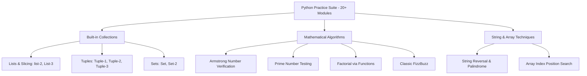

<p align="center">
  
</p>

<p align="center">
  
  
  
  
  
</p>

---

## Executive Summary / Overview
### Problem Statement & Context
A competitive software engineer must possess deep, intuitive command over data structure manipulation, sequence transformations, and algorithmic problem-solving across all standard collections (Lists, Tuples, Sets, Dictionaries).

### Solution Overview
This repository represents an exhaustive **Python Algorithmic Problem-Solving Suite** spanning **20 distinct Jupyter notebooks**. The modules provide complete implementations and test benches for fundamental algorithms—including Armstrong number verification, prime sieves, FizzBuzz, array searching, list-to-tuple transformations, and in-depth exploration of Python's built-in collections.

---

## Interactive Table of Contents
- [Executive Summary / Overview](#executive-summary--overview)
- [Key Features & Capabilities](#key-features--capabilities)
- [System Architecture / Pipeline](#system-architecture--pipeline)
- [Tech Stack Breakdown](#tech-stack-breakdown)
- [Reproducible Quickstart & Setup](#reproducible-quickstart--setup)
- [Project Directory Layout](#project-directory-layout)
- [Author & Contributions](#author--contributions)

---

## Key Features & Capabilities
- **20+ Specialized Problem Notebooks:** Granular, self-contained implementations of classic computer science interview challenges.
- **Collection Mastery:** In-depth coverage of Lists (`list-2.ipynb`, `List-3.ipynb`), Tuples (`Tuple-1.ipynb` to `Tuple-3.ipynb`), and Sets (`Set.ipynb`, `Set-2.ipynb`).
- **Mathematical & Number Algorithms:** Implementations of Armstrong numbers, prime testing, factorials, and FizzBuzz.
- **Array Search & Indexing:** Demonstrates position lookup, vector indexing, and boundary validation using pure Python and NumPy.

---

## System Architecture / Pipeline


---

## Tech Stack Breakdown
| Layer | Technology | Details |
| :--- | :--- | :--- |
| **Languages** | Python 3.10+ | Core language features, comprehensions, slicing |
| **Libraries** | NumPy (selective) | Array manipulations and index lookups |
| **Tools** | Jupyter Lab / Notebook | Interactive cell-based problem development |
| **Architecture** | Modular Algorithmic Suite | Decoupled individual problem testbeds |

---

## Reproducible Quickstart & Setup
```bash
# 1. Clone repository
git clone https://github.com/suryateja-155/python-practice.git
cd python-practice

# 2. Virtual environment setup
python -m venv venv
.\venv\Scripts\activate   # On Windows

# 3. Install packages
pip install numpy notebook

# 4. Launch Jupyter Lab
jupyter lab
```

---

## Project Directory Layout
```text
python-practice/
├── armstrong number.ipynb           # Armstrong number verification
├── prime number.ipynb               # Prime testing and factor checks
├── factorial using function.ipynb   # Factorial calculation using modular functions
├── fizzbuzz.ipynb                   # Classic FizzBuzz modulo interview question
├── list-2.ipynb                     # Advanced list transformations (24 cells)
├── List-3.ipynb                     # Additional list manipulations (21 cells)
├── Tuple-1.ipynb                    # Tuple immutability and packing (25 cells)
├── Tuple-2.ipynb                    # Tuple unpacking and indexing (12 cells)
├── Tuple-3.ipynb                    # Advanced tuple operations (11 cells)
├── Set.ipynb                        # Set theory and hash operations (15 cells)
├── Set-2.ipynb                      # Set intersections and differences (8 cells)
├── find the index position...ipynb  # Array position search logic
├── reverse string _ Palindrome.ipynb# Two-pointer string reversal
└── README.md                        # Master index and algorithmic cheat sheet
```

---

## Author & Contributions

**Gettupalli Surya Teja**  
- GitHub Profile: [@suryateja-155](https://github.com/suryateja-155)  
- Portfolio Index: [Gettupalli-Surya-Teja](https://github.com/suryateja-155/Gettupalli-Surya-Teja)

Contributions, issue reports, and feedback are always welcome! Feel free to open an issue or pull request.

<p align="center">
  
</p>
